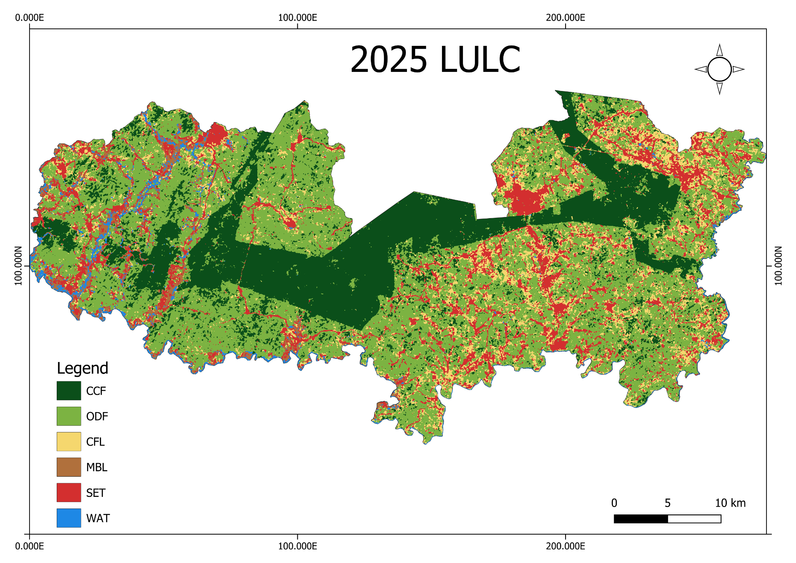

# 2025 Land Use/Land Cover Classification — Adansi South District

<figure markdown="span">
  
  <figcaption>2025 LULC classification map for Adansi South District. The map displays six mapped classes: closed forest, open/degraded forest, cropland and fallow, mining/bare land, built-up areas, and water.</figcaption>
</figure>

## Project overview

This Google Earth Engine (GEE) workflow maps land use and land cover (LULC) in Adansi South District, Ghana, for 2025. It uses Landsat 8 and Landsat 9 imagery and a Random Forest classifier to distinguish six land-cover classes.

The workflow is designed with two operating modes: a sample-picking mode for exploring predictor layers and potential training locations, and a classification mode for combining samples, training the model, producing the classified map, and exporting outputs.

## Land-cover classes

| Code | Class | Description |
|---:|---|---|
| 0 | CCF | Closed forest |
| 1 | ODF | Open / degraded forest |
| 2 | CFL | Cropland and fallow |
| 3 | MBL | Mining / bare land |
| 4 | SET | Built-up |
| 5 | WAT | Water |

## Imagery and predictor features

The script uses Landsat 8 and 9 surface-reflectance imagery. Its predictor stack is designed to combine spectral information and derived features, including dry-season bands, spectral indices, a yearly NDVI profile, and texture information. The script's comments and settings describe a dry-season composite spanning November 2024 to February 2025.

## Workflow

1. Define or import the Adansi South District boundary (`aoi`).
2. Prepare Landsat 8 and 9 imagery, including compositing and gap filling.
3. Derive spectral indices and additional predictor features.
4. In sample-picking mode, inspect predictor layers and potential sample locations for each class.
5. Load training samples either from an uploaded table or from six class-specific sample layers.
6. Train a Random Forest classifier and classify the study area.
7. Generate class-area summaries and export the mapped results.

## Running the script

Open the JavaScript file in the [Google Earth Engine Code Editor](https://code.earthengine.google.com/).

The script expects an imported district boundary named `aoi`. Depending on the selected sample workflow, it also expects either an uploaded table named `samples` with a numeric `class` field (values 0–5), or six sample layers named `CCF`, `ODF`, `CFL`, `MBL`, `SET`, and `WAT`.

The main settings at the beginning of the script control the workflow:

- `PICKING`: set to `true` to inspect predictor layers and potential sample locations; set to `false` to run classification and exports.
- `USE_UPLOADED_TABLE`: choose the uploaded sample table (`true`) or six separately imported/drawn class layers (`false`).
- `SAMPLE_GEOMETRY`: specify whether uploaded samples are points or polygons.
- `POINTS_PER_POLYGON`: number of random points generated within each training polygon.
- `START` and `END`: date range used for the dry-season composite.

Check all imports and settings before running. The script's source comments provide further instructions for preparing the samples.

## Map interpretation

The supplied map shows the spatial distribution of the six classes across the district. Closed forest (CCF) is represented in dark green, open/degraded forest (ODF) in light green, cropland and fallow (CFL) in yellow, mining/bare land (MBL) in brown, built-up areas (SET) in red, and water (WAT) in blue.

## Accuracy assessment and limitations

A classified map should not be treated as validated solely because it has been generated successfully. Before using the map in a report or decision-making process, review the script's accuracy-assessment outputs and document the sampling design, training/validation split, class-specific producer's and user's accuracies, overall accuracy, and any imbalance among classes.

Also consider:

- Whether training and validation samples are independent and spatially representative.
- Whether the dry-season image window is suitable for distinguishing seasonal cropland, fallow, and vegetation.
- Whether mining/bare land and built-up areas are spectrally separable at the chosen spatial resolution.
- Whether cloud, shadow, and image-gap handling leave artefacts in the composite.
- Whether the map boundary, class definitions, and reference labels are appropriate for Adansi South District.

## JavaScript source

The complete script is available below and as a separate file for use in the GEE Code Editor.

```javascript
--8<-- "gee-library/LULC/gee-library/scripts/lulc_2025_adansi_south.js"
```

[Open the JavaScript source file](scripts/lulc_2025_adansi_south.js)
