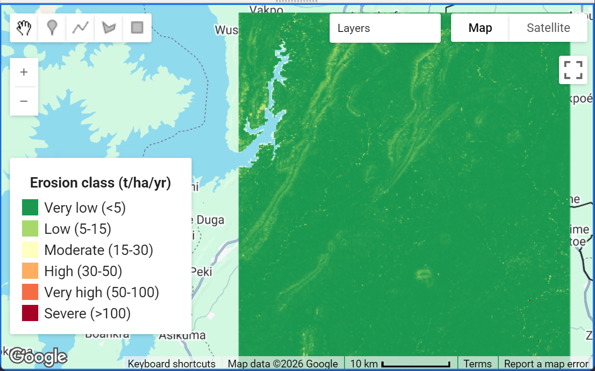

# RUSLE Soil Loss and Erosion Risk Mapping

[View JavaScript source](scripts/rusle_soil_loss.js){ .md-button .md-button--primary }
[Read the workflow](#project-overview){ .md-button }

<figure markdown="span">
  
  <figcaption>Example map output from the Google Earth Engine workflow. The legend groups estimated soil loss into six classes (t/ha/yr).</figcaption>
</figure>

## Project overview

This Google Earth Engine (GEE) workflow implements the Revised Universal Soil Loss Equation (RUSLE) to estimate potential average annual soil loss:

\[
A = R \times K \times LS \times C \times P
\]

where \(A\) is estimated soil loss (t ha⁻¹ yr⁻¹), \(R\) is rainfall erosivity, \(K\) is soil erodibility, \(LS\) represents slope length and steepness, \(C\) represents cover-management, and \(P\) represents support practices.

The script creates factor layers, an estimated soil-loss map, erosion-severity classes, summary statistics, and Google Drive export tasks.

## Data and methods

| Component | Source or method | Role |
|---|---|---|
| Rainfall erosivity (\(R\)) | CHIRPS daily precipitation; Modified Fournier Index and Renard–Freimund relationship | Estimates rainfall erosivity |
| Soil erodibility (\(K\)) | OpenLandMap sand, clay, and organic-carbon layers; EPIC-style equation | Represents soil susceptibility to detachment |
| Slope factor (\(LS\)) | MERIT Hydro elevation and upstream area; Moore–Burch formulation | Represents terrain effects |
| Cover-management (\(C\)) | ESA WorldCover lookup table or Sentinel-2 NDVI option | Represents land-cover protection |
| Support practice (\(P\)) | \(P=1\) by default, with an optional slope-based cropland parameterization | Represents conservation-practice assumptions |

## Main outputs

- Estimated annual soil loss raster (`A`, t/ha/yr).
- Six-category erosion-severity raster.
- Individual \(R\), \(K\), \(LS\), \(C\), and \(P\) factor layers.
- Mean, median, and maximum estimated soil loss.
- Estimated total soil loss and area by erosion class.
- Google Drive export tasks for the soil-loss map, classes, and factor stack.

## Configuration

Edit the settings near the beginning of the script before running it in the [Google Earth Engine Code Editor](https://code.earthengine.google.com/).

- `aoi`: replace the example rectangle with your study-area boundary.
- `RAIN_START_YEAR` and `RAIN_END_YEAR`: define the rainfall averaging period.
- `C_METHOD`: choose `'landcover'` or `'ndvi'`.
- `USE_P_SLOPE`: enable or disable the optional slope-based \(P\) factor.
- `SCALE`: set the analysis/export scale.
- `EXPORT_CRS`: choose an appropriate projected coordinate reference system for your study area.

## Example map

The supplied screenshot is included in the site at `docs/assets/images/rusle-erosion-map.png`. It illustrates the map interface and erosion-class legend; it should be presented as an example output, not as independent validation of the model.

## Important limitations and validation

RUSLE estimates sheet and rill erosion under the assumptions encoded in its factors. It does not directly model gully erosion, sediment routing, or sediment delivery to streams. The factors and their parameter values should be checked against local literature and field observations.

Before interpreting results, pay particular attention to:

- The rainfall-erosivity equation and its regional suitability.
- Soil-property units and the assumptions used to derive \(K\).
- The terrain data, flow accumulation interpretation, and LS-factor formulation.
- The land-cover-to-\(C\) lookup values and the season represented by Sentinel-2 composites.
- The \(P\)-factor values and whether they represent actual conservation practices.
- The analysis scale and output projection.

**Do not treat the map as field-validated soil loss.** Validate the parameterization and results for the intended location before using them for planning or policy.

## JavaScript source

The complete script is available [as a separate file](scripts/rusle_soil_loss.js) and is shown below. Use the copy button on the code block to copy it into the [Google Earth Engine Code Editor](https://code.earthengine.google.com/).

```javascript
--8<-- "gee-library/rulse/gee-library/scripts/rusle_soil_loss.js"
```

[Open the JavaScript file](scripts/rusle_soil_loss.js)

[Back to the GEE Library](../../index.md){ .md-button }
