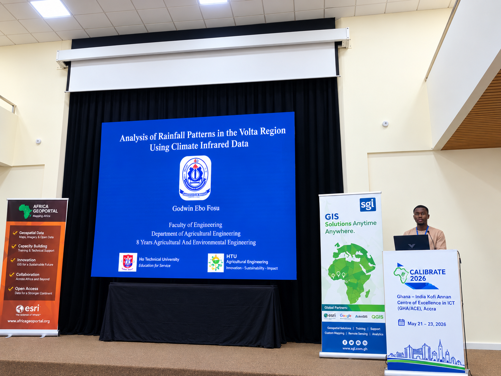

---
hide:
  - toc
  - navigation
---
<!--
CHECKLIST FOR THIS PAGE:
- [ ] Replace [YOUR NAME] with your full name (3 places)
- [ ] Replace [YOUR JOB TITLE] with your current or target role
- [ ] Replace [YOUR TAGLINE] with a short phrase describing your focus
- [ ] Rewrite the About Me paragraph with your own words
- [ ] Replace assets/images/profile.PNG with your actual photo (keep the filename or update it below)
- [ ] Replace the Home page hero background in assets/css/extra.css with an image from assets/images/
- [ ] Edit the skill cards to match your actual skills (add, remove, or rename cards as needed)
- [ ] Update GitHub and LinkedIn links in the Connect section
- [ ] Add your CV PDF to docs/assets/ and update the filename in the Download CV button
-->

  
  <h1>GODWIN EBO FOSU</h1>
  
<strong>Teaching and Research Assistant</strong>

  
<em>Geospatial Science for Climate Resilience and Sustainable Development | GIS | Remote Sensing | Python</em>

---

## About Me

I am a First-Class Agricultural and Environmental Engineering graduate specializing in GIS, remote sensing, and geospatial data analysis. I use Google Earth Engine, QGIS, ArcGIS, Python, and statistical methods to investigate hydroclimatic trends, support climate resilience, assess environmental conditions, and identify suitable locations for agricultural infrastructure. My research interests focus on the intersection of geospatial science, sustainable agriculture, water resources, and environmental management. I am currently seeking **GRA/GTA** opportunities in geospatial analysis, remote sensing, and environmental or climate research where I can contribute my technical skills while advancing my research experience.

  

---

[View My Projects :material-arrow-right:](projects/index.md){ .md-button .md-button--primary }
[Download CV :material-download:](assets/Godwin-CV.pdf){ .md-button }

---

## Skills

-   :material-layers:{ .lg .middle } **GIS & Remote Sensing**

    ---

    - QGIS, ArcGIS Pro, Google Earth Engine
    - GDAL / OGR, GRASS GIS
    - Multispectral and SAR image analysis
    - Cloud Native Geospatial (COG, STAC, Zarr)

-   :material-code-braces:{ .lg .middle } **Programming**

    ---

    - Python — GeoPandas, NumPy, Pandas, Matplotlib
    - R — sf, terra, ggplot2
    - JavaScript — Leaflet, MapLibre GL
    - SQL, PostgreSQL + PostGIS

-   :material-chart-box:{ .lg .middle } **Statistical Analysis & Visualization**

    ---

    - Python — NumPy, Pandas, Matplotlib
    - R — ggplot2 and spatial analysis with sf and terra
    - Statistical data analysis and visualization workflows

-   :material-file-document:{ .lg .middle } **Productivity Software**

    ---

    - Microsoft Office Suite — Excel, Word, PowerPoint

-   :material-star-four-points:{ .lg .middle } **Machine Learning & GeoAI**

    ---

    - Supervised classification — Random Forest, XGBoost
    - Deep learning for image segmentation — U-Net, SAM
    - scikit-learn, PyTorch, TensorFlow
    - Object detection in satellite imagery

-   :material-earth:{ .lg .middle } **Web Mapping & Data**

    ---

    - Leaflet.js, Folium, MapLibre GL JS
    - Cloud storage — AWS S3, Google Cloud Storage
    - Data formats — GeoTIFF, GeoParquet, NetCDF
    - Streamlit for data-driven web apps

-   :material-database:{ .lg .middle } **Data & Cloud**

    ---

    - PostgreSQL + PostGIS
    - Cloud storage: AWS S3, Google Cloud Storage
    - Data formats: GeoJSON, GeoTIFF, NetCDF, Zarr, GeoParquet

-   :material-airplane:{ .lg .middle } **Drone / UAV Data Processing**

    - Mission planning and flight operations
    - Photogrammetry: Agisoft Metashape, OpenDroneMap
    - Point cloud processing: CloudCompare, PDAL

---

## Connect

[GitHub](https://github.com/godwinebo/){ .md-button }
[LinkedIn](https://www.linkedin.com/in/godwin-ebo-fosu-5a1752246/?isSelfProfile=true){ .md-button }
